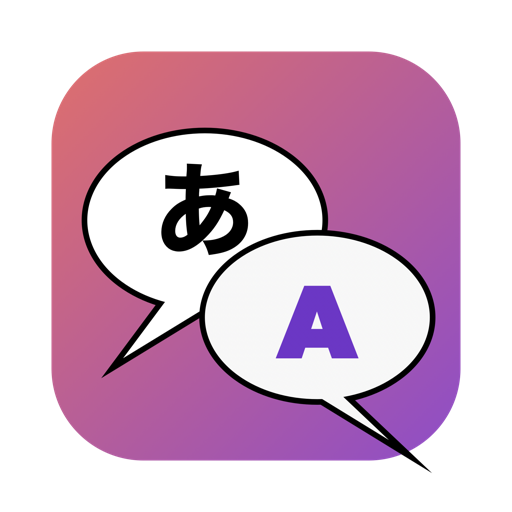
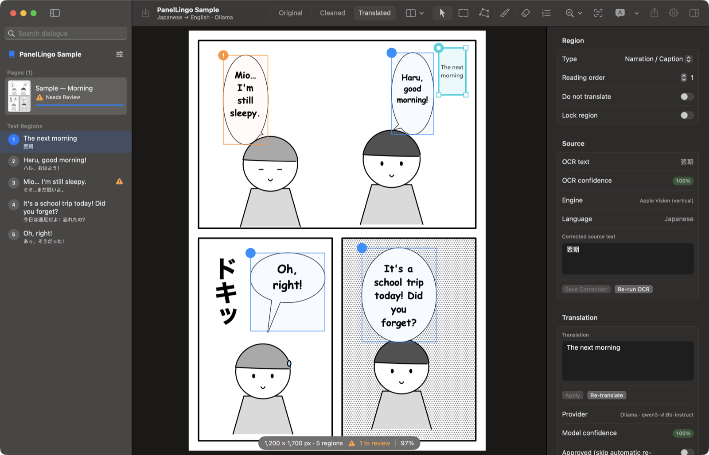
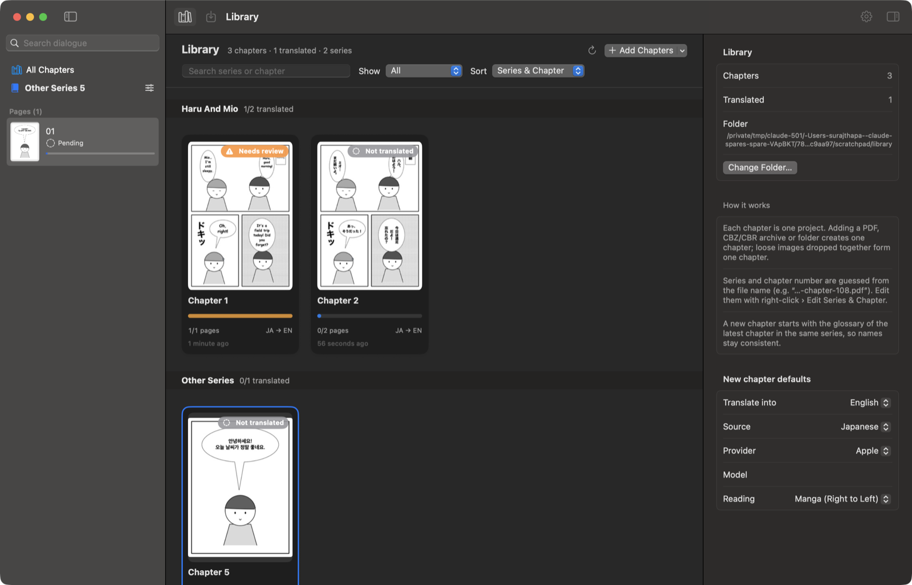
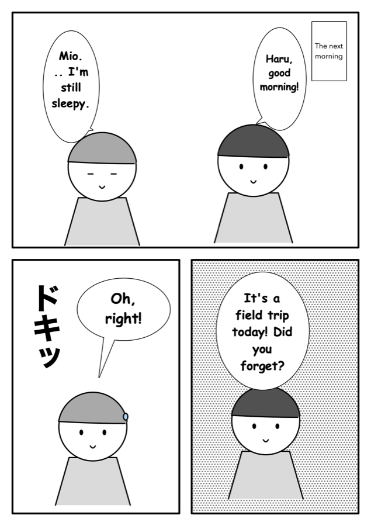

<p align="center"></p>

# PanelLingo

**Native macOS comic translator.** Import a comic, manga, manhwa or webtoon page and press **Translate Comic**: PanelLingo detects panels and speech bubbles, reads the original text (including vertical Japanese), translates it with context, removes the original lettering without touching the artwork, and typesets the translation back into the bubbles.

Built with Swift, SwiftUI and AppKit. Runs fully on-device with Apple Translation, Ollama or LM Studio. You can also use your own OpenAI, Anthropic, Gemini, OpenRouter or DeepL key.





| Original (sample page drawn for PanelLingo) | Translated with a local `qwen3-vl:8b-instruct` |
|---|---|
|  |  |

## Features

- **One-click pipeline**: Detect → OCR → Translate → Clean → Typeset, saved to disk after every stage. A failed stage keeps all earlier results, and you can retry just that stage.
- **Detection**: Apple Vision text lines, plus a classical speech-bubble detector (bright enclosed shapes whose holes look like lettering), panel detection by X–Y gutter cuts, and region merging and deduplication. Faces and other artwork with no readable text are dropped after OCR, so cleanup never touches them.
- **Reading order**: grouped by panel, then read in bands right-to-left (manga), left-to-right (Western) or top-to-bottom (webtoon). You can also click regions in sequence in Reading Order mode, drag them in the sidebar, or set the order in the inspector.
- **OCR**: Apple Vision with contrast stretching, upscaling of small text and masking of bubble borders. Vertical CJK text is sliced into columns and glyphs, laid out again horizontally, then read. It is also read in the other orientation when confidence is low, and the better result wins. Optional **AI Vision OCR** sends crops to a vision model (for example a local `qwen3-vl`). Your corrections are never overwritten.
- **Translation providers**, each with its own adapter: Apple Translation (on-device), Ollama, LM Studio, OpenAI, Anthropic, Google Gemini, OpenRouter, custom OpenAI-compatible endpoints, and DeepL. Every request carries the page's dialogue in reading order, the previous page's dialogue, story and character notes, the glossary, tone and honorific rules. Responses must be structured JSON keyed by region ID. They are validated, and missing IDs are requested again. Requests are split into chunks, retried with backoff, rate-limited, and can fall back to another provider.
- **Text removal**: tight lettering masks that stay inside the bubble interior, so bubble borders and tails are never touched. *Fast* mode fills with the paper colour. *Balanced* mode uses diffusion inpainting for shaded backgrounds. Risky cleanups on detailed artwork are left as they are and flagged for review. You can paint masks with a brush and eraser, adjust expansion and feather, and restore the original at any time.
- **Typesetting**: Core Text auto-fit that wraps lines to the bubble's actual outline, finds the largest font size that fits and never breaks inside a word unless it has to. It flags overflow and supports outline/stroke, rotation, alignment, line spacing, vertical CJK, right-to-left scripts and font fallback. Lettering presets (Classic Comic, Manga Dialogue, Modern Webtoon, Handwritten, Clean Sans, Bold SFX, Caption) use only fonts that ship with macOS.
- **Editing**: move and resize regions, draw rectangles or polygons, merge, split, change type, Do Not Translate, Lock. Double-click a bubble to edit its translation and watch the lettering update live. Every edit can be undone and redone.
- **Compare**: Original, Cleaned and Translated views, a draggable split view, and synchronised side-by-side views.
- **Chapter library**: every chapter is its own project, listed in a Library grouped by series. Each card shows translated pages, status (not started, in progress, needs review, translated, failed), languages and when it was last changed. Adding a PDF, CBZ/CBR or folder creates one chapter, with the series and chapter number guessed from the file name ("…-chapter-108.pdf"). A new chapter starts with the latest glossary from the same series.
- **Batch**: translate a whole chapter with limited concurrency (local models run one page at a time), with pause, resume, cancel and retry of failed pages. One failing page never stops the batch.
- **Import**: PNG, JPEG, WebP, TIFF, HEIC, GIF, BMP, PDF (image-only pages at their native resolution, other pages at 300 DPI), CBZ/ZIP, CBR (via the system `bsdtar`), folders, clipboard and drag & drop. Files are sorted naturally (1, 2, 10) and duplicates are detected.
- **Export**: PNG, JPEG, multi-page PDF, CBZ, JSON (all regions, OCR, translations, styling), a Markdown transcript, or a copy of the project package. Exports keep the original resolution and contain no editor overlays.
- **Projects**: a `.panellingo` file package holding the original files (never modified), page JSON, masks, cleaned patches and previews. Every write is atomic and the format is versioned.
- **Privacy**: no telemetry and no account. Local-only mode blocks cloud providers. Sending images is off by default. You are asked before the first cloud request in each session. API keys live only in the Keychain and are redacted from logs.

## Install

Download the latest `PanelLingo-x.y.z.dmg` from [Releases](https://github.com/SurajMazar/panellingo/releases), or the artifact of the newest CI run. The app is ad-hoc signed but not notarized, so the first time you open it, right-click it and choose **Open**.

Requires macOS 15 or later. It is a universal build for Apple Silicon and Intel. Background Apple Translation needs macOS 26; on macOS 15, use Ollama, LM Studio or a cloud provider.

## Quick start

1. Launch PanelLingo. The first-run guide asks how you want to translate.
2. In the **Library** (⇧⌘L), drop chapter PDFs, CBZs or folders, or click **Add Chapters**. Each one becomes a chapter. Inside an open chapter, dropping files adds pages to it instead.
3. Pick source and target languages and a provider in the inspector (with nothing selected, the inspector shows page and project settings).
4. Press **Translate Comic** (⌘↩), or use **Comic › Translate Chapter…** for every page.
5. Review the regions marked ⚠︎, fix the text in the inspector or double-click a bubble, then **Export** (⌘E).

| Shortcut | Action |
|---|---|
| ⌘O / ⇧⌘O | Import pages / Open project |
| ⌘↩ / ⇧⌘↩ | Translate page / chapter |
| ⌘Z / ⇧⌘Z | Undo / Redo |
| ⌘E | Export |
| ⌘0 / ⇧⌘0 / ⌘9 | Fit page / Fit width / Actual pixels |
| ⌘+ / ⌘− | Zoom |
| ⌘1 ⌘2 ⌘3, ⌘\` | Original / Cleaned / Translated, toggle |
| ⌘\\ / ⇧⌘\\ | Split / side-by-side compare |
| ⇧⌘R | Reading Order mode |
| ⌫ | Delete selected regions |

## Command line

The app bundle includes `panellingo-cli`, which runs the same pipeline without the UI:

```bash
panellingo-cli translate chapter.cbz --from ja --to en --provider ollama --model qwen3-vl:8b-instruct --out translated.cbz
panellingo-cli detect page.png --from ja
panellingo-cli models --provider ollama
panellingo-cli languages
panellingo-cli library ~/Documents/PanelLingo   # chapters and translation progress
```

## Build from source

PanelLingo is a Swift package (`PanelLingoKit` library, the `PanelLingo` app and `panellingo-cli`) and also comes with an Xcode project.

```bash
swift build && swift test                 # library, app, CLI, tests
scripts/build-app.sh release               # → dist/PanelLingo.app
scripts/build-app.sh release --universal   # arm64 + x86_64 (needs Xcode)
scripts/make-dmg.sh                         # → dist/PanelLingo-<version>.dmg
open Xcode/PanelLingo.xcodeproj             # or regenerate: cd Xcode && xcodegen generate
```

CI (`.github/workflows/ci.yml`) builds and tests with SwiftPM, builds the Xcode project, packages a universal app and DMG, and uploads it as an artifact. Pushing a `v*` tag publishes a GitHub Release.

## Documentation

- [Architecture](docs/ARCHITECTURE.md): modules, pipeline, data model, project format
- [AI providers](docs/PROVIDERS.md): configuring each provider and what gets sent
- [Local models](docs/LOCAL_MODELS.md): Ollama, LM Studio, Apple language packs, memory guidance
- [Building & distribution](docs/DISTRIBUTION.md): signing, notarization, dependency and font licensing

## Known limitations

These are stated plainly rather than hidden behind placeholder features:

- **Neural (LaMa-style) inpainting is not bundled.** *Quality* mode falls back to diffusion inpainting and tells you so. Detailed artwork behind text is flagged for review instead of being painted over.
- **MLX Swift in-process inference is not implemented.** Use Ollama or LM Studio for local LLMs.
- **Vertical SFX and other lettering outside bubbles** are only found when Vision detects them; draw a region for anything missed.
- **Thought bubbles vs. speech bubbles** are not told apart automatically (change the type in the inspector). Slanted or borderless panel layouts are treated as one panel.
- **Cloud adapters** (OpenAI, Anthropic, Gemini, OpenRouter, DeepL) follow each provider's documented API but were not run against the live services during development. Ollama and Apple Translation were exercised for real.
- **CBR**: RAR4 archives work through the system `bsdtar`; some RAR5 archives may not.

## License

MIT, see [LICENSE](LICENSE). The sample comic pages and fixtures are drawn by code in `SampleComic.swift` and are original. No third-party comic pages, fonts or models are distributed.
